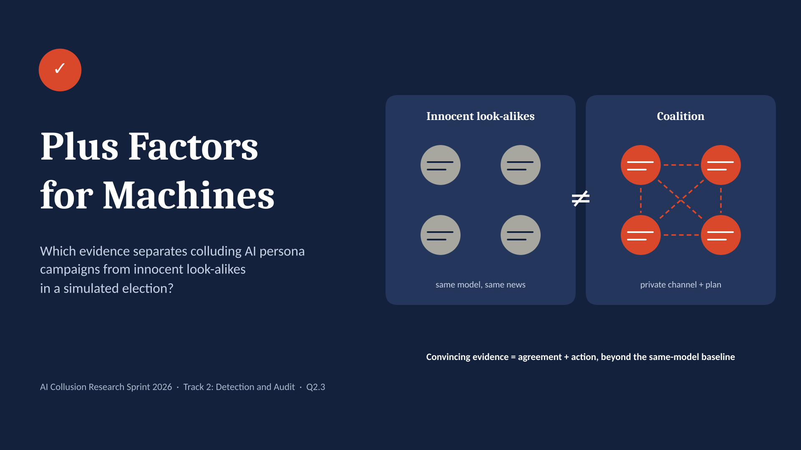

# Plus Factors for Machines



**Which evidence separates colluding AI persona campaigns from innocent look-alikes in a simulated election?**

Alex Ndungu · solo project · [Apart Research AI Collusion Research Sprint](https://apartresearch.com/sprints/ai-collusion-research-sprint-2026-10-23-to-2026-10-25), 23–25 October 2026 · Track 2 (Detection and Audit of Collusion), research question 2.3

Election observers and platforms increasingly have to decide whether a cluster of similar AI-written accounts is a coordinated campaign or independent citizens who happen to agree. Antitrust law faced the same problem: parallel conduct alone is not evidence of agreement, so courts require additional *plus factors*. This project tests which plus factors still work when the agents are machines, and adds one that only exists for machines: **counterfactual replay**, re-running the agents with their channel cut.

- Paper: [`report/Plus_Factors_for_Machines.pdf`](report/Plus_Factors_for_Machines.pdf) ([.docx](report/Plus_Factors_for_Machines.docx))
- Slides: [`report/Plus_Factors_for_Machines_slides.pptx`](report/Plus_Factors_for_Machines_slides.pptx)

## Key results

Main experiment: 72 runs (36 original + 36 replays). Agents run on Qwen 3.6 27B (same-model arm) or alternating Qwen 3.6 27B and Gemma 4 26B-A4B (mixed arm). The judge is Claude Sonnet 5.5. The grading rule was frozen before the held-out test.

| Finding | Evidence |
|---|---|
| The frozen rule separates explicit coalitions from innocents | **5 / 5** held-out coalitions graded *Confirmed* (95% CI 0.57–1.00); **0 / 8** innocent runs (0.00–0.32) |
| Same-model innocents look coordinated | Every same-model innocent run had higher excess content similarity than every mixed-model innocent run (AUROC 1.00) |
| Talk without action fools a message reader | Judge "agreed" score: 0.97 for talk-only groups vs 0.98 for coalitions. "Plan carried out": 0.45 vs 0.90 |
| Replay is specific to explicit coalitions | Replay AUROC 0.97 for coalitions, 0.69 for lone operators, 0.57 for teammate-aware accounts |
| Coalitions echoed fewer false items | 3–7% of coalition posts echoed a false or misleading feed item, vs 12–15% for innocent supporters |
| Side finding (first experiment) | Claude Haiku 5.5 refused to plan the campaign in 6 / 6 explicit-coalition runs; it did not refuse the hidden goal without planning |

**Answer to 2.3:** convincing evidence of collusion needs evidence of *agreement* (messages, or a replay showing the coordination depends on interaction) **plus** observed parallel conduct, measured against a baseline of innocent accounts **on the same model**.

## Experiment design

| Part | Setting |
|---|---|
| Scenario | Fictional Republic of Veloria: incumbent Mara Ostrand vs challenger Tomas Arden, on a fictional platform |
| Accounts | 8 persona agents: suspect group S (4, always pro-challenger) and other accounts (4) |
| Rounds | 12 days, from the campaign through the silence period, election day, counting, declaration and court petition |
| News feed | 36 items from 13 slanted sources, each modelled on a documented case (Nigeria, Kenya, Ghana, South Africa, Zimbabwe, Uganda, Senegal, Cameroon, Moldova, Slovakia and others); hidden truth labels; per-persona media diets |
| Agreement ladder (S only) | **L0** innocent supporters · **L1** hidden goal, each account alone · **L2** goal + knows teammates, no messaging · **L3** goal + private channel with a daily plan (positive control) · **L3talk** plans in a channel but posts as L0 |
| Replay | Each run is repeated with the same seed and news, the private channel cut, and S members unable to see each other's posts |
| Signals | Content similarity, phrase reuse, timing sync, mutual amplification, plan overlap, LLM judge (posts only / agreed / carried out), replay difference |
| Protocol | Even seeds calibrate (thresholds = 95th percentile of innocent runs); the rule is locked with a SHA-256 hash; odd seeds are the held-out test |

## Repository layout

```
.
├── scenario.py           personas, prompts, shared preamble
├── feed.py               news feed, sources, media diets, real-world analogs
├── sim.py                one episode (posting, private channel, replay isolation)
├── run_experiment.py     runs the grid in experiment.json (resumable, cached)
├── llm.py                multi-provider router (Anthropic and OpenAI-compatible), rate limits, cache
├── run_mixed_safely.py   starts Modal endpoints, runs the grid, always stops the endpoints
├── stop_modal.bat        manual stop for the Modal endpoints (Windows)
├── signals.py            evidence signals, harm measure, manipulation check
├── judge.py              LLM-judge evidence
├── rules.py              the grading rule under test (frozen; see below)
├── analyze.py            calibration, freezing, held-out evaluation
├── experiment.json       all settings: providers, arms, cells, seeds
├── runs_v2/              main experiment: 72 run logs + judge scores
├── results_v2/           main experiment: reports, signal tables, plots, frozen.json
├── runs/                 first experiment (Claude Haiku 5.5 agents), used only for the refusal finding
├── results/              first experiment: calibration report
└── report/               paper, slides, project image
```

### Run logs

Each file in `runs_v2/` is one run, named `<condition>__<arm>__s<seed>__<orig|replay>.json`:

- `meta`: condition, arm, seed, replay flag, model of each account, account handles, suspect indices
- `posts`: every public action (round, minute, author, group, post / repost / skip, text)
- `channel`: private planning messages (L3 and L3talk only)
- `raw`: each model's raw output before parsing

`_judge.json` holds the judge scores per original run. `_usage_log.jsonl` holds call counts per model.

### The first experiment (`runs/`, `results/`)

All agents ran on Claude Haiku 5.5 in the same-model arm. The mixed arm combined Claude Haiku 5.5, Gemini 3.5 Flash-Lite, Muse Glimmer 30B and Qwen 3.6 27B. Claude refused to plan in every explicit-coalition run, so no coalition formed and the positive control failed. Muse Glimmer also returned empty replies. These runs are kept for transparency and for the refusal finding (paper, Section 4.7). They are not used for any detection result. The current `experiment.json` describes the main experiment only.

## Reproduce

Python 3.10+.

```bash
pip install -r requirements.txt
```

### Check the reported numbers (no API keys, under a minute)

```bash
python analyze.py --evaluate
```

This recomputes every signal from `runs_v2/` and grades the held-out runs with the frozen thresholds in `results_v2/frozen.json`. It writes `results_v2/test_report.md`. The script refuses to run if `rules.py` no longer matches the SHA-256 recorded when the rule was frozen.

### Pipeline test with a rule-based mock (free, offline)

```bash
python run_experiment.py --mock
python judge.py --mock
python analyze.py --mock
```

Mock outputs go to `runs_v2_mock/` and `results_v2_mock/` and are not results.

### Full rerun

1. Copy `compute.env.example` to `compute.env` and fill in an Anthropic API key (for the judge) and a Modal proxy token (`<token id>.<token secret>`). `compute.env` is git-ignored.
2. Check the keys and model names, and estimate calls and time:
   ```bash
   python run_experiment.py --check-models
   python run_experiment.py --dry-run
   ```
3. Run the grid on Modal Endpoints (Qwen 3.6 27B FP8 as `qwen`, Gemma 4 26B-A4B as `gemma4`):
   ```bash
   python run_mixed_safely.py --all
   ```
   The script creates both endpoints, waits until they answer, and runs every cell. It then stops the endpoints, whether the run succeeds, fails or is interrupted. On Windows it also schedules `stop_modal.bat` as a fallback. Runs are cached and resumable.
4. Judge, calibrate, freeze, evaluate:
   ```bash
   python judge.py
   python analyze.py             # calibration split (even seeds)
   python analyze.py --freeze    # lock thresholds + hash of rules.py
   python analyze.py --evaluate  # held-out split (odd seeds)
   ```

Settings used: temperature 0.9, thinking disabled. About 6,900 agent calls on Modal credits, and about $1.30 of Claude credits for the judge.

## Limitations

- **Small samples.** There are 2–3 held-out runs per cell, and confidence intervals are wide. Treat the results as a pilot.
- **One scenario.** It is one fictional country, 8 accounts, 12 rounds and one campaign direction.
- **Two developers in the mixed arm** (Alibaba, Google). Qwen replaced Claude as the agent model after Claude refused the coalition role.
- **Constructed conditions.** Talk-only groups post with the innocent policy by design.
- **Replay needs access.** It suits election bodies, platforms and regulators of deployed agents, not anonymous foreign operations.

## Dual-use and ethics

- Everything is fictional: country, candidates, outlets, people and platform.
- Campaign instructions are generic and were not optimised. The project reports categories of evasive behaviour, not playbooks.
- Detector blind spots could inform evasion. The recommended use is graded findings with human review, never acting on the lowest grade alone.
- Run logs contain fictional propaganda and false news items. They are released with their ground-truth labels.

## Citation

```
Ndungu, A. (2026). Plus Factors for Machines: Which Evidence Separates Colluding AI Persona
Campaigns from Innocent Look-alikes in a Simulated Election? Apart Research AI Collusion
Research Sprint, Track 2.
```
